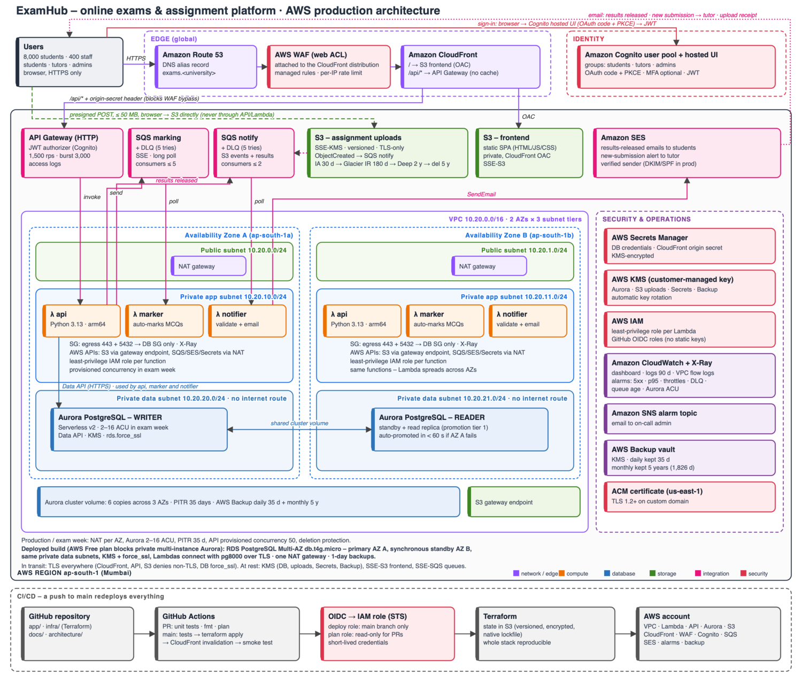
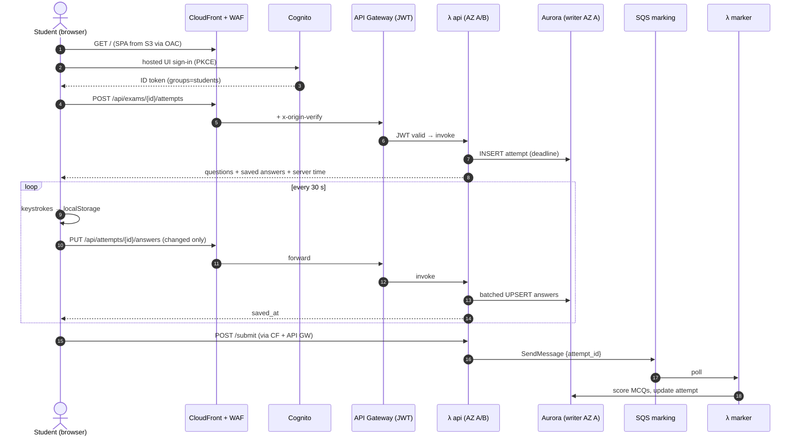
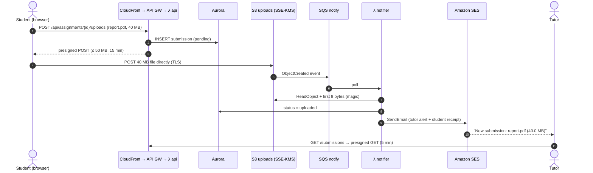

# Architecture – ExamHub online exam & submission platform

The vector version is [diagram.svg](diagram.svg). It is generated by [generate_diagram.py](generate_diagram.py). To rebuild the PNG, run `python3 architecture/generate_diagram.py` and export the SVG.

## Components by tier

| Tier | Where | Components |
|---|---|---|
| Edge (global) | outside the region | Route 53 (DNS), CloudFront (CDN, TLS), AWS WAF (web ACL on CloudFront), ACM certificate |
| Identity | regional, multi-AZ managed | Cognito user pool, hosted UI, groups `students` / `tutors` / `admins` |
| Frontend | S3 + CloudFront | Static SPA in a private S3 bucket, read only by CloudFront Origin Access Control (OAC) |
| API | regional, multi-AZ managed | API Gateway HTTP API with a Cognito JWT authorizer and throttling |
| Compute | **private app subnets, AZ A + AZ B** | Lambda `api`, `marker`, `notifier`, `migrate` (Python 3.13, arm64, X-Ray) |
| Database | **private data subnets, AZ A + AZ B** | Aurora PostgreSQL Serverless v2: writer in AZ A, reader/failover target in AZ B, reached through the RDS Data API |
| File storage | regional | S3 uploads bucket: SSE-KMS, versioning, TLS-only policy, lifecycle 30 d → IA, 180 d → Glacier IR, 2 y → Deep Archive, deleted after 5 y |
| Async processing | regional | SQS `marking` and `notify` queues, each with a DLQ, consumed by Lambda; SES for email |
| Networking | VPC 10.20.0.0/16 | 2 × public subnets (NAT gateway), 2 × private app subnets, 2 × private data subnets (no internet route), S3 gateway endpoint, security groups, VPC flow logs |
| Secrets & keys | regional | Secrets Manager (DB credentials, CloudFront origin secret), customer-managed KMS key with rotation |
| Monitoring | regional | CloudWatch dashboard, logs, alarms → SNS email; X-Ray traces; VPC flow logs |
| Backup | regional | Aurora point-in-time restore (35 days in production; 1 day on the Free-plan lab account) and AWS Backup (daily kept 35 d, monthly kept 5 y) |
| CI/CD | GitHub + AWS | GitHub Actions → OIDC → IAM role → Terraform (S3 remote state) → `apply`, CloudFront invalidation, smoke test |

How each requirement is met:

| Requirement | How |
|---|---|
| Role-based sign-in | Cognito groups end up in the JWT `cognito:groups` claim. API Gateway verifies the token, and every route in `api.py` checks the role. |
| Timed MCQ + short-answer exams | The server stores `deadline_at = min(start + duration, exam close)`. The client timer uses the server clock offset. Autosaves after the deadline (plus 60 s grace) are rejected. |
| Autosave every 30 s | The SPA keeps a local copy of every keystroke and, every 30 s, sends a `PUT /api/attempts/{id}/answers` with only the changed answers. The server does a batched upsert. |
| Auto-marking of MCQs | Submit sends a message to SQS `marking`. The `marker` Lambda scores the attempt, and it is safe to run more than once. |
| PDF/ZIP uploads ≤ 50 MB | A presigned POST enforces `content-length-range` and the content type. The notifier checks the file's first bytes (magic bytes) to confirm it really is a PDF or ZIP. |
| Email on results release | Release sends a message to SQS `notify`. The notifier sends SES email and records `results_emailed_at`, so a retry never emails anyone twice. |
| 99.9 % availability, survives loss of one AZ | Two AZs for compute and database, managed multi-AZ services, Aurora auto-failover (see below) |
| RPO ≤ 5 min | Aurora writes synchronously to storage in 3 AZs (RPO ≈ 0 for committed data). The browser holds at most 30 s of unsaved typing, and PITR covers corruption. |
| RTO ≤ 1 h | AZ failure: automatic, under 2 minutes. Region-level or data corruption: PITR restore plus `terraform apply`, about 30–45 minutes. |
| 5-year retention | S3 lifecycle expires files after 1,826 days. AWS Backup monthly snapshots are kept 1,826 days. |
| Encryption in transit and at rest | TLS on every hop (CloudFront redirect-to-https, S3 deny `aws:SecureTransport=false`, Aurora `rds.force_ssl=1`). KMS for Aurora, uploads, Secrets and Backup. SSE-S3 for the frontend, SSE-SQS for the queues. |

---

## Walkthrough 1 – A student opens an exam and answers autosave

1. **DNS and edge.** The student browses to the site. Route 53 resolves the alias to CloudFront, WAF inspects the request (managed rules and rate limit), and CloudFront returns `index.html` / `app.js` from the private S3 frontend bucket through OAC, cached at the edge.
2. **Sign-in.** There is no token yet, so the SPA redirects to the Cognito hosted UI with a PKCE challenge. After the password (and optional MFA) step, Cognito redirects back with a code. The SPA exchanges the code for an ID token whose `cognito:groups` claim contains `students`.
3. **Open the exam.** The student clicks **Start exam**, and the SPA sends `POST /api/exams/{id}/attempts` with `Authorization: Bearer <JWT>`. CloudFront's `/api/*` behaviour forwards the request without caching and adds the secret `x-origin-verify` header. API Gateway's JWT authorizer checks the signature, expiry and audience, then invokes the `api` Lambda (running in private subnets in AZ A or AZ B).
4. **Create the attempt.** The Lambda checks the origin header, the `student` role and that the exam window is open. Through the RDS Data API it inserts an `attempts` row with `deadline_at = least(now() + duration, closes_at)`. This write goes to the Aurora writer, and the storage layer copies it to 3 AZs. The response contains the questions **without** the correct answers, any saved answers, and the server time.
5. **Answering.** The SPA renders the questions and a countdown driven by the server's deadline. Every change is written to `localStorage` at once.
6. **Autosave (every 30 s).** The SPA sends `PUT /api/attempts/{id}/answers` containing only the answers that changed. The Lambda checks the student owns the attempt and that `now() ≤ deadline + 60 s`, then runs a single batched `INSERT … ON CONFLICT DO UPDATE`. The UI shows "Saved 3 answer(s) at 10:31:05".
7. **Failure handling.** If a save fails (network drop, AZ failover), the answers stay dirty in `localStorage` and are re-sent on the next tick or when the browser comes back online. **Submit**, or the timer reaching zero, sends `POST /submit`. The status becomes `submitted` and a message goes to SQS `marking`, where the `marker` Lambda auto-marks the MCQs.

## Walkthrough 2 – A student uploads a 40 MB assignment and the tutor is notified

1. **Request an upload slot.** The student picks `report.pdf` (40 MB). The SPA sends `POST /api/assignments/{id}/uploads {filename, size}` through CloudFront and API Gateway (JWT checked) to the `api` Lambda.
2. **Validate and presign.** The Lambda checks the extension (PDF/ZIP) and size (≤ 50 MB), cleans the filename, and inserts a `submissions` row with `status = pending`. It returns an **S3 presigned POST** that is valid for 15 minutes and fixes the key `submissions/{assignment}/{submission}/report.pdf`, the `Content-Type`, and `content-length-range 1–52,428,800`.
3. **Direct upload.** The browser POSTs the 40 MB file **straight to the S3 uploads bucket** over TLS and shows a progress bar. The file never passes through API Gateway (10 MB payload limit) or Lambda (6 MB). S3 encrypts it with the KMS key, and versioning protects it from being overwritten.
4. **Event.** S3 sends an `ObjectCreated` event to the SQS `notify` queue.
5. **Verify.** The `notifier` Lambda (event source mapping, at most 2 concurrent) finds the submission by its S3 key. It reads the real size with `HeadObject` and reads the first 8 bytes to check the PDF or ZIP magic bytes. It then marks the submission `uploaded` (or `rejected`) and tags the object.
6. **Notify.** The notifier sends an SES email to the **tutor** who owns the assignment ("New submission: student1 submitted report.pdf (40.0 MB)…", flagged LATE if past the due date) and a receipt to the student. If processing fails, SQS retries it up to 5 times. After that the message goes to the DLQ, which triggers a CloudWatch alarm that emails the admin through SNS.
7. **Tutor download.** The tutor opens **Submissions**. The `api` Lambda returns a presigned GET link that expires after 5 minutes. Later, lifecycle rules move the file to cheaper storage classes and delete it after 5 years.

---

## How the design handles the exam peak and the loss of one AZ

*(≤ 300 words)*

**Exam peak.** When 3,000 students start within five minutes, that is about 10 starts per second. Once everyone is writing, autosave adds 3,000 ÷ 30 s = 100 requests per second. CloudFront serves the SPA from edge caches. API Gateway (throttle 1,500 rps, burst 3,000) and Lambda scale per request. Before exam week the Lambda quota is raised to 1,000 and 50 provisioned-concurrency environments remove cold starts. With requests of about 100 ms, roughly 10–20 concurrent executions carry the load. The RDS Data API is HTTPS-based, so Lambdas never exhaust PostgreSQL connections, and Aurora Serverless v2 is held at a minimum of 2 ACU and scales to 16 within seconds. Autosaves send only changed answers as one batched upsert. Slow work (MCQ marking, file checks, email) goes through SQS with capped consumers, so a burst of 3,000 submissions queues instead of overloading the database or SES. WAF exempts campus NAT addresses from the per-IP limit, so exam halls are never blocked.

**Loss of one AZ.** Every tier runs in two AZs. CloudFront, Route 53, WAF, Cognito, API Gateway, S3, SQS and SES are managed multi-AZ services. Lambda has network interfaces in private subnets in both AZs and stops placing invocations in an impaired one. In production, each AZ has its own NAT gateway. Aurora writes every change synchronously to six copies across three AZs, so no committed answer is lost. If the writer's AZ fails, the reader in the other AZ is promoted in under a minute. During that window the Data API wrapper retries, and the browser keeps unsaved answers locally and re-sends them on the next autosave. At most about 30 seconds of typing is at risk (RPO target 5 minutes), and recovery is automatic within minutes (RTO target 1 hour).

---

## Production vs lab settings

The diagram shows production. The Terraform defaults are cheaper lab settings, and each one can be switched with a variable:

| Setting | Lab default | Exam week / production |
|---|---|---|
| NAT gateways | 1 (`high_availability_nat=false`) | 1 per AZ (`true`) |
| Database | RDS PostgreSQL Multi-AZ `db.t4g.micro` (Free plan blocks Aurora, see below) | Aurora Serverless v2, 2–16 ACU |
| API provisioned concurrency | 0 | 50 (after the Lambda quota increase) |
| Lambda account concurrency | 10 (new-account default) | 1,000 (Service Quotas request) |
| Backup / PITR window | 1 day (AWS Free-plan accounts are capped) | 35 days |
| Deletion protection | off (so tear-down works) | on |
| Custom domain + ACM | CloudFront domain | `domain_name` + `hosted_zone_id` |
| SES | sandbox (verified addresses only) | production access, DKIM/SPF on the university domain |

### Deployed database on the Free plan

The AWS account used for the deployment is on the Free plan, which only allows Aurora in "express configuration" (one instance, outside the VPC, internet-reachable). Deploying that would mean a public, single-AZ database, so the deployed build uses **RDS for PostgreSQL Multi-AZ** instead: primary in AZ A, synchronous standby in AZ B, in the same private data subnets, encrypted with the same KMS key and with `rds.force_ssl=1`.

What changes in the walkthroughs: the `api` Lambda reaches the database with the `pg8000` driver over TLS on port 5432 instead of the HTTPS Data API. The schema, queries and flows are the same. What changes in AZ loss: RDS promotes the standby and moves the endpoint's DNS name in 60–120 s (Aurora: under 60 s). The Lambda database client reconnects with backoff, and the browser keeps unsaved answers and re-sends them, so the RPO and RTO targets are still met. `scripts/simulate-az-failure.sh` demonstrates this with `reboot-db-instance --force-failover`.
